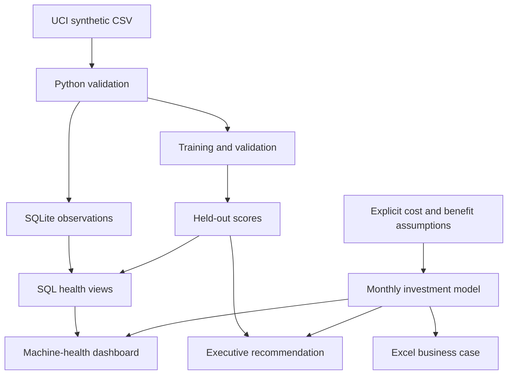

# Manufacturing Data Modernization & AI Business Case

**Should a factory invest in a centralized data platform and predictive maintenance, and is the benefit worth the cost?**

An independent portfolio project by **Aditya Satrasala** connecting a working Python/SQL prototype to an investment decision. It uses public synthetic data, explicit cost assumptions, and a staged implementation recommendation. It is not a client engagement or a deployment at Toyota, Hitachi, Deloitte, or another company.

## Three deliverables

| Deliverable | Open it | What it demonstrates |
|---|---|---|
| Machine-health dashboard | [Portable dashboard](dashboard/standalone.html) | Holdout observations, review alerts, model evidence, financial sensitivity, and rollout plan |
| Excel business case | [Manufacturing_Business_Case.xlsx](reports/Manufacturing_Business_Case.xlsx) | Editable assumptions, monthly cash flows, NPV, payback, and break-even reduction |
| Five-slide executive recommendation | [Executive_Recommendation.pptx](reports/Executive_Recommendation.pptx) | Recommendation, measured prototype evidence, investment comparison, risks, and 90-day plan |

Download the portable HTML file and open it in a browser. GitHub displays its source instead of running it. The dashboard runs entirely on your computer and requires no account, API key, or paid cloud service.

## Run in five minutes

Requires Python 3.11 or newer. Python 3.12 is used in CI.

```bash
git clone https://github.com/AdityaSat/manufacturing-data-modernization.git
cd manufacturing-data-modernization
python -m venv .venv
```

Activate the environment:

```bash
# macOS / Linux
source .venv/bin/activate

# Windows PowerShell
.venv\Scripts\Activate.ps1
```

```bash
pip install -r requirements.txt
python run.py build
python run.py dashboard
```

Open **http://localhost:8000**. The original UCI CSV is included, so rebuilding does not require a dataset download. To explicitly refresh it, run `python run.py build --download`.

For a dashboard-only demonstration, `python run.py dashboard` uses the included results and needs only Python's standard library. Alternatively, double-click `dashboard/standalone.html`.

## What the prototype actually found

The model classifies **failure in the current synthetic observation**. It does not predict a validated future breakdown horizon.

| Holdout result | Basic monitoring | Random forest |
|---|---:|---:|
| Failure recall | 56.4% | 74.4% |
| Alert precision | 22.9% | 42.6% |
| Failures detected | 22 / 39 | 29 / 39 |
| Missed failures | 17 | 10 |
| False alarms | 74 | 39 |
| Total alerts | 96 | 68 |

The test set has 2,000 observations. Random-forest average precision is **0.761**. The threshold of **0.14** maximizes validation F2 within a 10% validation alert-capacity ceiling. Holdout alert rate is 3.4%. The same fixed threshold generates the dashboard's main register. Its separate threshold explorer is explicitly post-test exploration.

The model has better detection and fewer false alarms than this simple baseline, but **42.6% precision is below the proposed 50% pilot target**. The limited number of held-out failures and synthetic process rules restrict what these results establish. These findings support further validation, not production readiness.

See [model card](docs/model_card.md) and [machine-readable metrics](reports/model_metrics.json).

## Illustrative investment decision

The financial model assumes 20 critical assets, 4,000 scheduled hours per asset annually, 5% unplanned downtime, and $200 of avoidable loss per machine-hour. These imply an $800,000 annual downtime loss pool. They are **planning assumptions**, not figures observed in the UCI dataset or supplier quotes.

| 36-month base assumptions | Basic monitoring | Predictive maintenance |
|---|---:|---:|
| Implementation | $65,000 | $145,000 |
| Annual operating costs | $18,000 | $50,000 |
| Assumed downtime reduction | 12% | 25% |
| Steady annual gross savings | $96,000 | $200,000 |
| Steady annual net benefit | $78,000 | $150,000 |
| NPV, 10% annual discount rate | $102,557 | $171,591 |
| Cash payback with ramp | 15.5 months | 17.6 months |

Predictive maintenance has approximately **$69,034 higher modeled NPV**. It needs **21.1% total downtime reduction** to equal monitoring's NPV while monitoring remains at 12%. Its own NPV reaches zero at a lower 15.4% reduction. These answer different questions: *is the option worthwhile?* and *is the incremental investment worthwhile?*

**Recommendation:** build the monitoring foundation and validate predictive maintenance in a limited pilot. Stage the illustrative full-program envelope and finalize the pilot budget during discovery. Scale only after actual warning time, inspection workload, and attributable avoided downtime support the incremental economics. Do not infer 25% downtime savings from 74.4% model recall.

Benefits are zero in months 1–3, 50% in months 4–6, and 100% thereafter. Full recurring costs start in month 1. The estimate is pre-tax, uses month-end cash flows, and excludes financing, inflation, terminal value, and separate labor or energy savings. Avoid counting one production-line stoppage against multiple assets. Details: [business-case methodology](docs/business_case.md).

## How it works



The repository is deliberately small. Python performs ingestion and modeling. SQLite provides persistent analytical tables and SQL views. A browser dashboard reads an exported JSON snapshot. The target production architecture and governance decisions appear in [architecture](docs/architecture.md).

## Reproducibility and tests

```bash
python run.py build
python -m unittest discover -s tests -v
# Optional, with Node.js installed
node tests/check_dashboard_math.mjs
```

Tests cover input rejection, exclusion of target labels and IDs, separated data blocks, threshold capacity, SQL/metric reconciliation, cost timing, zero-benefit cases, and the incremental NPV break-even boundary. The JavaScript test compares dashboard calculations with Python results. CI rebuilds from the bundled CSV before testing.

The build refreshes SQL, JSON results, holdout CSV, and the portable dashboard. **The Excel workbook and presentation are reviewed reporting snapshots.** They do not automatically refresh when Python inputs change. Edit the Excel assumptions for a new scenario and update the slides to match. Exact source-package versions, seed, split ranges, and source checksum are recorded in the model report.

## Repository map

| Path | Purpose |
|---|---|
| `src/manufacturing/pipeline.py` | Validation, feature allowlist, modeling, SQL load, and exports |
| `src/manufacturing/business.py` | Auditable monthly investment calculations |
| `sql/warehouse.sql` | Observation health and product-quality aggregation views |
| `dashboard/` | Browser interface, portable copy, and tested calculator |
| `config/business_assumptions.json` | Authoritative base assumptions for Python/dashboard rebuilds |
| `data/raw/ai4i2020.csv` | Original public synthetic data |
| `powerbi/` | Power Query, DAX, and build guide for a Power BI failure-drivers report |
| `reports/` | Workbook, deck, metrics, cash flows, and holdout predictions |
| `docs/` | Architecture, model card, methodology, and interview walkthrough |

## Data attribution and license

**AI4I 2020 Predictive Maintenance Dataset.** UCI Machine Learning Repository (2020). [DOI: 10.24432/C5HS5C](https://doi.org/10.24432/C5HS5C). Dataset license: [CC BY 4.0](https://creativecommons.org/licenses/by/4.0/). The raw CSV is redistributed unchanged. Derived features and model outputs are project transformations. See [data provenance](data/README.md).

Project code is MIT licensed. Dataset rights remain under CC BY 4.0. No employer or client information is included.

For a guided explanation, start with [the interview walkthrough](docs/interview_walkthrough.md).
